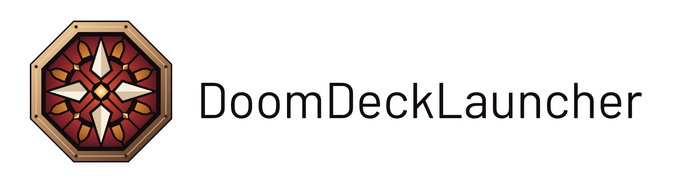
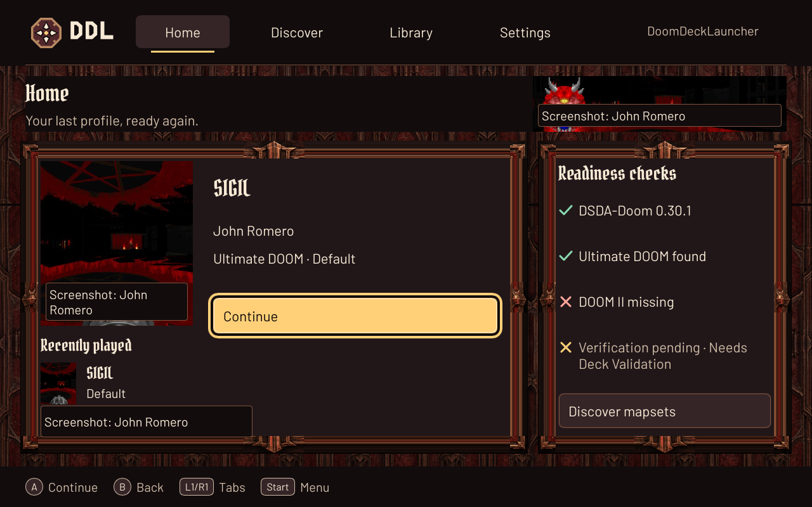
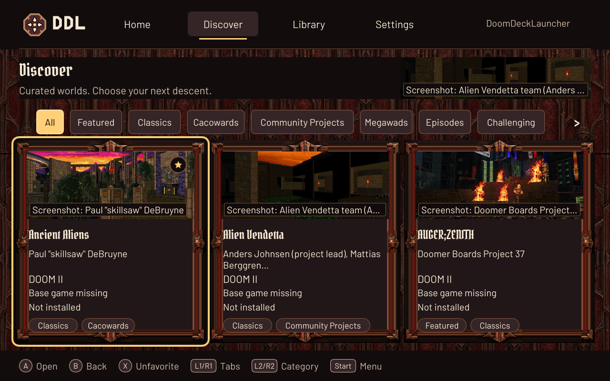
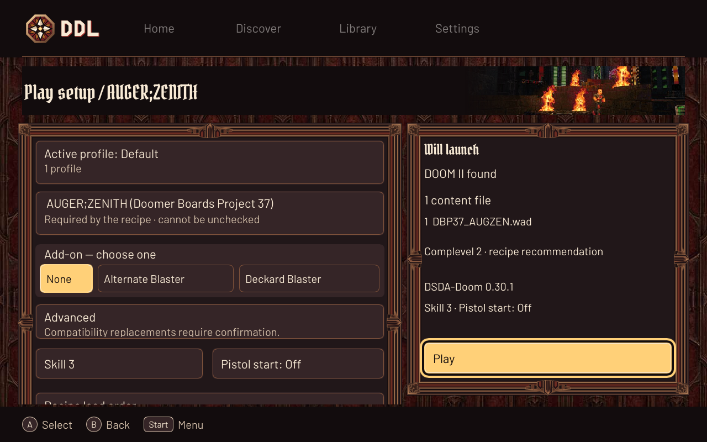
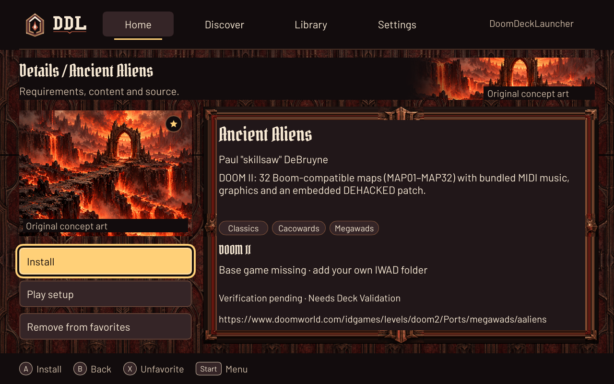
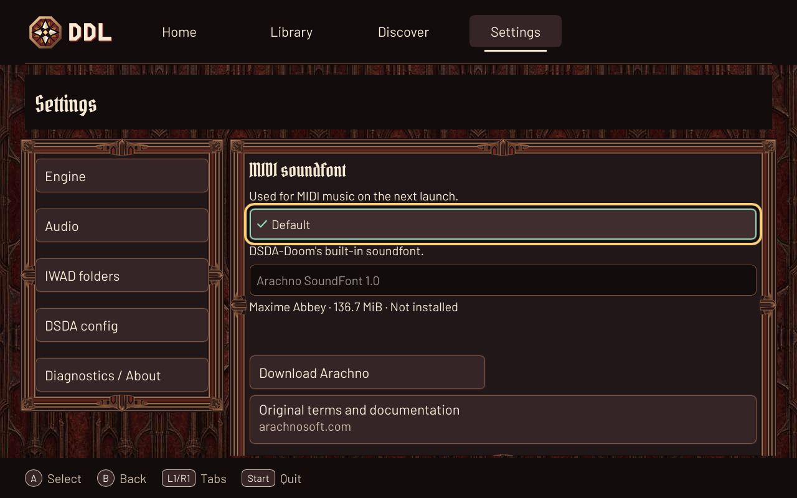

<picture><source media="(prefers-color-scheme: dark)" srcset="docs/design/logo/readme-logo-dark.png"></picture>

# DoomDeckLauncher

> [!NOTE]
> This project is developed and maintained with the help of AI agents, under the direction and
> review of its human maintainer.

**A native, controller-first DOOM mapset launcher for Steam Deck, powered by the official [DSDA-Doom](https://github.com/dsda-org/dsda-doom) AppImage.**

Discover community maps, choose your setup, and play from Gaming Mode.
Built in Rust and [Slint](https://slint.dev).

**Pre-alpha:** these screenshots show the current source tree; published releases may lag.
**Needs Deck Validation:** Gaming Mode, input handoff and gameplay — [test checklist](docs/deck-testing.md).

| Home | Discover |
| --- | --- |
|  |  |
| Play setup | Mapset detail |
|  |  |

*1280×800 off-screen renders of the real Slint UI with sample state, refreshed from the current source. Original DDL interface artwork; embedded map imagery belongs to its respective creators ([credits](packaging/flatpak/site/credits.html)). Audio shows the built-in default and optional Arachno download, not an installed soundfont.*
Click an image to inspect it at 1280×800.

## Features

- Controller-first navigation with an Ember Cathedral interface.
- Curated mapset recipes with explicit components and load order.
- Discover categories, tags and persistent favorites.
- Independent catalog updates at startup, with a safe offline fallback.
- Install the official DSDA-Doom AppImage, with an extraction fallback.
- Find your own IWADs; keep engine settings and saves isolated.
- Diagnose engine, IWAD and mapset problems with the same `ddl` command-line tools.

## Install on Steam Deck

In Desktop Mode, open [the DDL website](https://www.vitormach.dev/Doom-Deck-Launcher/),
choose **Install on Steam Deck**, and open the downloaded `.flatpakref` in Discover.
Install DDL there, then follow the [Steam shortcut instructions](docs/steam-deck-guide.md#flatpak-discover)
to launch it from Gaming Mode. This experimental signed Flatpak receives app updates through
Discover; the mapset catalog updates inside DDL. Physical Deck installation checks are still pending.

Alternatively, use the portable Linux tarball:

1. In Desktop Mode, download `ddl-linux-x86_64.tar.gz` from [GitHub Releases](https://github.com/vittau/Doom-Deck-Launcher/releases) (checksum included).
2. Extract it somewhere convenient and keep the `ddl/` directory together.
3. Steam → **Games → Add a Non-Steam Game → Browse** → select the extracted `ddl` executable.
4. In the shortcut's Properties, **leave Compatibility → Force a compatibility tool off**.
5. Launch DDL, install DSDA-Doom and add a folder containing your legally owned IWADs.
6. Return to Gaming Mode; configure [Classic or Modern + Gyro controls](docs/steam-deck-guide.md#recommended-steam-deck-controller-setup), then discover a mapset and play.

[Steam Deck guide](docs/steam-deck-guide.md) ·
[Steam artwork](docs/steam-deck-guide.md#make-it-look-native-in-steam) ·
[Konsole troubleshooting](docs/steam-deck-guide.md#troubleshooting-from-konsole) ·
[Build from source](docs/steam-deck-guide.md#build-from-source) ·
[Contribute a mapset](CONTRIBUTING.md)

## License

DDL is licensed under the **GNU General Public License, version 3 or later**
(GPL-3.0-or-later). See [`LICENSE`](LICENSE).

DDL is not affiliated with, endorsed by, or sponsored by id Software, Bethesda
Softworks, ZeniMax, Microsoft, Valve Corporation, Doomworld, or the DSDA-Doom
maintainers. **DOOM** is a trademark of id Software LLC; **Steam** and **Steam Deck**
are trademarks of Valve Corporation. All trademarks belong to their respective
owners and are used here only to describe what DDL does.

## Credits

- **[UZDeck](https://github.com/karkusviktor/UZDeck)** and
  **[GZDeck](https://github.com/flegald/GZDeck)** — the projects that inspired DDL.
  DDL is an independent reimplementation; no original code or assets have been
  reused.
- **[DSDA-Doom](https://github.com/dsda-org/dsda-doom)** — the DOOM source port DDL
  targets, used unmodified as the official AppImage.
- **[Slint](https://slint.dev)** — the native UI toolkit DDL is built with.
- **[doom_widehud](https://github.com/NightFright2k19/doom_widehud)** — widescreen
  status bars by NightFright and contributors (GPL-3.0).
- The DOOM mapping community, whose mapsets DDL exists to make playable.
