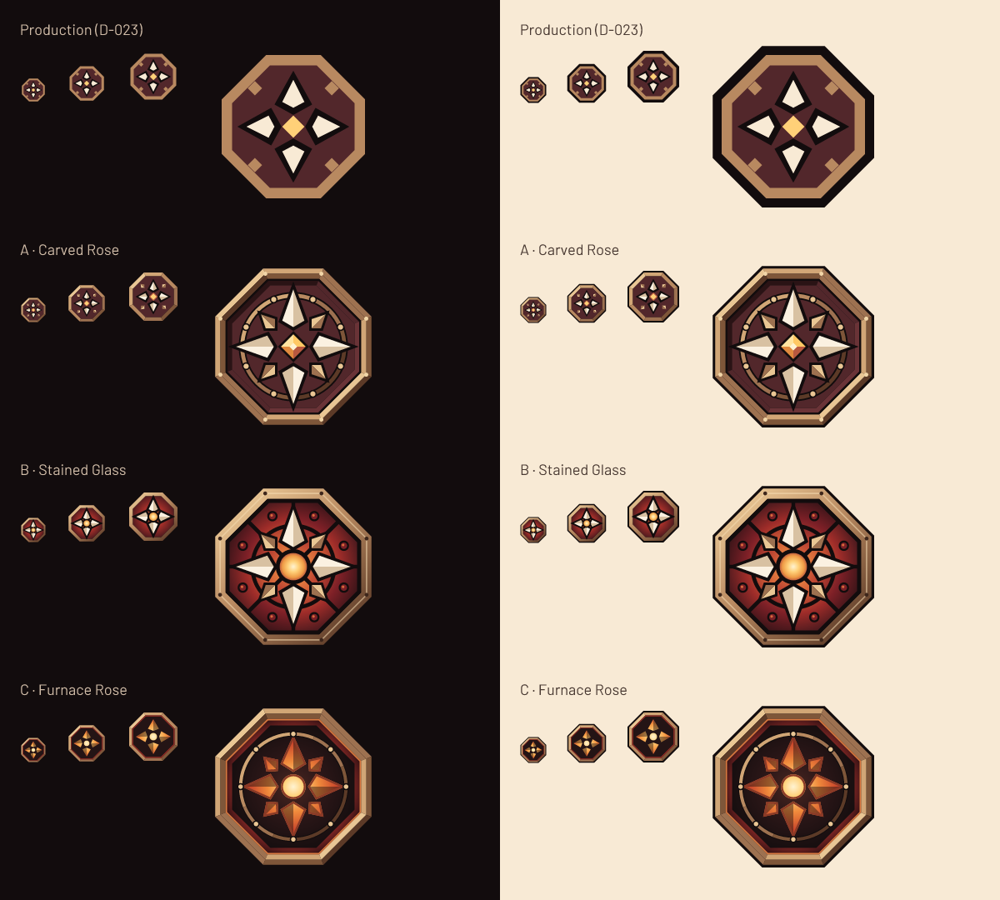

# Logo v3 — a richer Rose Compass (spec 036)

Three candidate evolutions of the Rose Compass (D-023). Each one keeps the
octagonal rose window, the compass reading, a single ember focus and the
upright DDL wordmark, and adds craft: carved mouldings, tracery, glass, metal
and ember tones. The owner picked **B · Stained Glass** (D-029) and spec 039 made it the
production logo: `../logo/author.py` imports this folder's `author.py` (the one
authoring source) and its masters are byte-identical to `stained-glass/`.
A and C remain here as the comparison record.



Every emblem starts with the exact production outer octagon
(`M80 4H176L252 80V176L176 252H80L4 176V80Z`), so the silhouette is unchanged
and `export.py --check` enforces it. Original artwork is GPL-3.0-or-later.
Sheet labels and mock copy are Barlow and Pirata One outlines from the bundled
fonts ([SIL OFL notice](../../../crates/ddl/ui/assets/Barlow-OFL.txt)); the
emblems and the wordmark contain no lettering from any font. There are no
franchise marks, game imagery or franchise lettering.

## Variants

| Variant | Idea | Strengths | Risks |
| --- | --- | --- | --- |
| [A · Carved Rose](carved-rose/contact-sheet.png) | Craft through carving: flat fills only, with no gradients. A two-slope bronze moulding with eight rivets, a carved recess wall, a round tracery ring with eight bosses, bevelled bone cardinals, bronze ordinals and a faceted ember gem. | Closest to D-023. The small tier keeps the production leads and petals **exactly** and adds only bevel shading and an ember ring, so there is no risk at 32 px. Flat fills render the same in every renderer. | Least new colour: mostly new tones of the existing hues, which may undershoot "more colours". At 128 px the bosses and rivets are 1–2 px. Eight points and a ring lean towards a generic nautical compass rose. |
| [B · Stained Glass](stained-glass/contact-sheet.png) — **owner's pick, refined in round 2** | Colour through real leaded glass. A lead-came network cuts each 45° bay into an inner quarry, a deep-amber pointed lancet and two ruby side panes whose came runs out to the octagon's corner. A lead ring carries faceted amber jewels where it crosses the diagonal leads. The frame is gradient metal with rivets, and the ember is a small faceted amber lozenge (the D-023 diamond). | Answers "more detail **and** more colour" most directly, with two glass hues (ruby and deep amber) and varied pane shapes. The four bone points lead the read again, and the small ember stays the brightest point. The small tier (bone star over ruby glass with eight deep-amber lancets) stays legible at 32 and 48 px on dark and light. | The most detailed of the three: at 128 px the cames are about 1 px and the jewels are specks. At 32 px the lancets blur into warm patches behind the star. It uses the most red, near the UI's ember and danger accents. It depends on gradients; the Slint renderer check below covers them. |
| [C · Furnace Rose](furnace-rose/contact-sheet.png) | A carved stone plate, backlit. The compass star and oculus are cut through dark stone, so a furnace glow shines through. A bronze dial ring has bosses on all eight points, and a hot lip lines the frame. | The strongest DOOM mood (hell-glow behind carved stone) and the most distinctive. The ember literally lights the whole mark. The dial composition is clean. | Furthest from D-023: no bone petals, so the emblem is darker overall and less recognisable as the current mark. At 32 px the orange star on near-black has the lowest contrast of the three. It can read as a "fire" or "sun" icon. |

**Status:** after the coordinator's review, the owner picked **B** for a
second round (refined as described above) and kept the solid DDL wordmark on
the dark tablet. A and C remain as the comparison record; they share the
updated lock-up tablet.

## Scale tiers (R3)

Each variant has two emblems:

- `emblem.svg` (full tier) is for **128 px and up**.
- `emblem-small.svg` (small tier) is for **32–64 px**: the app and window
  icons, and the 56 px header lock-up. It has the same silhouette with the
  fine ornament removed.

Each contact sheet also shows the full tier at 32–64 px, labelled
"reference", to show why the small tier exists: at those sizes the full tier
turns into noise.

`horizontal.svg` uses the **small-tier** emblem in the same 330×128 frame as
the production horizontal master. Its main use is the 154×56 header slot,
where the emblem is drawn at 56 px. The wordmark is the D-023 DDL contours,
with three additions:

- the DDL sits on a **dark tablet** that has the octagon's 45° corner cuts.
  The tablet is the header's own `#120C0D`, so it is invisible in the app; on
  light grounds it keeps the bone letters from bleeding into the background.
  The production wordmark disappears there entirely. The tablet hugs the
  letters with about 8 units of margin and leaves a clear gap to the emblem,
  so it weighs as little as possible on light grounds.
- each letter is an exact extruded solid: a continuous dark outline and a
  carved side in the variant's depth colour, built as convex sweeps with
  see-through counters, so no seams or light slivers appear.
- a bone face (in C, the face warms to amber at the bottom).

The DDL is centred vertically on the emblem.

## Contact sheets

Each `contact-sheet.png` is 1440×2528 at native scale and contains:

- a title band;
- a **dark** panel and then a **light** panel, each with the small tier at
  32/48/64, the full tier at 32/48/64 as reference, and the full tier at
  128/256/512;
- the horizontal lock-up at native 330×128 and at header size 154×56, on dark
  and on light;
- a **1280×800 app-shell mock** with the lock-up in the header slot. The slot
  geometry comes from `app-window.slint`; the wall art is replaced by flat
  vector stand-ins, because no raster is allowed here.

`comparison.png` sets production next to A, B and C.

## SVG rules (R2) and sizes

The SVGs use only `svg`, `defs`, `g`, `path`, `linearGradient`,
`radialGradient` and `stop`, with fills, fill rules and fill opacity. There are
no strokes, filters, masks, clip paths, images, embedded raster, text, fonts,
scripts or external references. Gradients use `userSpaceOnUse`, so they stay
correct when an emblem is scaled inside a lock-up. `--check` enforces an
allowlist of elements and attributes and accepts `url()` only for a gradient
id defined in the same file.

| File | A · Carved Rose | B · Stained Glass | C · Furnace Rose |
| --- | ---: | ---: | ---: |
| `emblem.svg` | 5,979 B | 7,882 B | 6,255 B |
| `emblem-small.svg` | 1,630 B | 4,203 B | 1,510 B |
| `horizontal.svg` | 2,906 B | 5,479 B | 3,027 B |

For comparison, the production `emblem.svg` is 814 B.

## Slint renderer check (R2)

The app draws these SVGs with Slint 1.18.1, which uses resvg 0.48.1. The check
rendered them headlessly with Slint's software renderer, using a throwaway
probe in the session scratchpad that is not in the repository. It built
against this repository's `Cargo.lock`, with the SVG support that the app's
`backend-winit` feature enables.

It rendered every v3 `emblem.svg` and `emblem-small.svg` at 32, 56, 256 and
512 px, and every `horizontal.svg` at 165×64, 330×128 and 660×256, then
compared each one pixel by pixel with resvg 0.47.0 on the same `#120C0D`
background. The largest channel difference was **1/255** for the emblems and
**1/255** or less for the final lock-ups, the same anti-aliasing rounding that the
production masters show. The gradients therefore render identically in the
app's renderer. There are no filters to prove.

## Reproduce

Run from the repository root. resvg is a design-time tool, not a project
dependency.

```sh
cargo install resvg --version 0.47.0 --locked --root /tmp/ddl-logo-tools
python3 docs/design/logo-v3/export.py --resvg /tmp/ddl-logo-tools/bin/resvg
python3 docs/design/logo-v3/export.py --resvg /tmp/ddl-logo-tools/bin/resvg --check
```

`export.py` needs only the Python stdlib. `--check` does three things:

- validates every SVG in this folder;
- verifies that each emblem's outer contour is the production silhouette;
- re-renders the contact sheets and the comparison to scratch and asserts byte
  equality with the committed PNGs.

To change geometry, edit `author.py` and run it with `fonttools==4.60.1`
(`python3 -m venv /tmp/ddl-logo-author-venv && /tmp/ddl-logo-author-venv/bin/pip install fonttools==4.60.1`),
then export again. `author.py` reads the D-023 emblem `../logo-v2/rose-compass/emblem.svg` only
for the comparison sheet, and never writes outside this folder. No image
generation was used.
