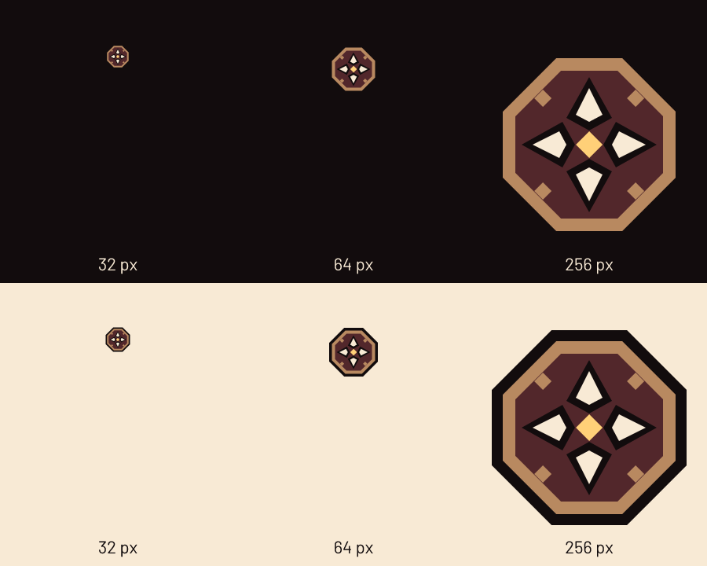

# Rose Compass · Stained Glass

Original DDL identity (D-029, owner pick of 2026-10-19, applied by spec 039). It evolves
the Rose Compass of D-023: an octagonal bronze frame around a lead-came stained-glass
rose in red and deep amber, small amber jewels, a bone compass star that leads the read
and a single small amber ember. The wordmark is the solid, upright DDL on a dark tablet.
Nothing derives from franchise marks, game textures or map screenshots. Original artwork
uses GPL-3.0-or-later; Barlow outlines retain the bundled SIL OFL notice.

Design record, the two other candidates and the renderer check: [`../logo-v3/`](../logo-v3/README.md).
The previous D-023 production masters are kept as history in
[`../logo-v2/production-d023/`](../logo-v2/README.md#production-history).

## Masters

| File | Use |
| --- | --- |
| `emblem.svg` | **Full tier**, 128 px and up. |
| `emblem-small.svg` | **Small tier**, 32–64 px: the window icon, the 256 px Steam icon and the header lock-up. Same silhouette, fine ornament removed. |
| `horizontal.svg` | Lock-up (small-tier emblem + DDL on a dark tablet), 330×128. Header slot: 154×56, **144 px minimum width**. |
| `stacked.svg` | Full-tier emblem over DDL and the name, 480×400; **240 px minimum width**. Loading screen. |
| `full-name.svg` | Full-tier emblem beside the name, 700×160; **350 px minimum width**. Settings → About. |
| `readme-header-dark.svg` | README header (370×160, displayed at 185×80): small-tier emblem + DDL wordmark + Barlow subtitle, bone ink for GitHub's dark theme. Matches the website header composition (spec 081). |
| `readme-header-light.svg` | Same compact header, dark ink (`#120C0D`) and the same ruby carved side, for GitHub's light theme. |
| `readme-logo-dark.svg` | Superseded full-name lock-up (760×200), bone name; kept as a reference mark, no longer used by README. |
| `readme-logo-light.svg` | Same reference lock-up with dark ink (`#120C0D`) for light grounds. |

Never use the full tier below 64 px or the small tier above 64 px. Leave at least one eighth
of the emblem's height clear on every side. Preserve proportions and colours. The dark outer
silhouette separates the emblem from light grounds; `horizontal.svg` carries its own dark
tablet for the lettering. `stacked.svg`, `full-name.svg` and the Steam `logo.png` set the
name in bone on a transparent ground, so use them on near-black or give them a dark plate
or use a matching transparent variant. The README uses the compact
`readme-header-dark.svg` / `readme-header-light.svg` pair from the website header
composition, in a `<picture>` with a dark-theme `<source>` and the light variant as its
fallback ``. Both keep the same small-tier emblem, DDL contours and Barlow subtitle
without a background tablet; only the fills change between themes.
Busy art needs a dark plaque, or a scene composed to shade the lettering as the Steam
capsules are (see Steam artwork).

SVG rules (spec 013 R2, extended by D-029): paths, `linearGradient`/`radialGradient` and
`stop` only, in `userSpaceOnUse`, plus `fill-opacity` (the contact sheet also nests `svg`
viewports to clip the Steam scenes); no raster, filters, strokes, masks, live fonts or external
references. `export.py --check` enforces the allowlist and the D-023 outer silhouette.



## One authoring source

`author.py` imports the geometry, palette and outlined lettering from
`../logo-v3/author.py` (the single source of truth, never copied), composes the
masters and the Steam compositions, and compiles `emblem`, `emblem-small`, `horizontal`,
`stacked` and `full-name` into `crates/ddl/ui/assets/logo/`. `emblem`, `emblem-small`
and `horizontal` are byte-identical to `../logo-v3/stained-glass/`; `export.py --check`
asserts it. The README header composes the same small-tier emblem, DDL contours and an
outlined Barlow subtitle; only its theme fills are specific to it. The Steam scenery comes
from `scene.py` (next section), which `author.py` calls; nothing in the three Steam SVGs is
edited by hand.

## Steam artwork

Spec 054, approved by the owner on 2026-10-20 (design round 1). The capsules and the hero
are original, detailed Ember Cathedral interiors (D-021), drawn procedurally by
[`scene.py`](scene.py): clustered piers with foliate capitals, moulded pointed arches with
bronze dogtooth, lancet windows in lead quarries under quatrefoil oculi, a sixteen-petal
rose window, carved spandrel roundels, stone courses with weathered blocks, bronze
braziers, light shafts, vault gloom and a vignette. Soft light and shade are stacked
translucent shapes (`fill-opacity`), so the files keep to the allowlist below. Fixed seeds
and two-decimal coordinates make every rebuild byte-identical.

- **Capsules:** the emblem, the DDL wordmark and `DoomDeckLauncher` sit directly on the
  scene, with no plate, tablet or box. The emblem sits in a carved octagonal recess; the
  lettering falls in the shaded lower half of the great arch (library) or on a shaded wall
  bay beside the lit apse (wide). `export.py --check` asserts that the lettering contours
  equal `stacked.svg`, that no opaque flat-colour rectangle covers more than 5% of the
  frame, and that the name keeps at least 4.5:1 against the bare scene (14:1 and 8.5:1
  today).
- **Hero:** no mark and no text. The lit apse (rose, lancet triplet, braziers) sits in the
  centred 860×380 safe area that Steam keeps uncropped; the side bays fall into shadow, so a
  centred crop at any aspect keeps the focus. Steam lets the publisher place the logo at
  the bottom left, top centre, middle or bottom centre
  ([Steamworks: Library Assets](https://partner.steamgames.com/doc/store/assets/libraryassets)).
  Use **bottom left**: `logo.png` then sits over the dark floor and side bay; centred, it
  would cover the bright apse.
- **Limits:** all files are far below SteamGridDB's static upload limits of 15 MB for grids
  and logos and 24 MB for heroes, which `export.py --check` enforces
  ([research, section 5.4](../../research/steam-shortcuts.md#54-size-format-and-style-rules)).
  `logo.png` is unchanged and transparent.

## Exports

| PNG | Source | Size |
| --- | --- | --- |
| `crates/ddl/ui/assets/logo/icon.png` (window icon) | `emblem-small.svg` | 256×256 |
| `steam/icon-256.png` (same bytes as the window icon) | `emblem-small.svg` | 256×256 |
| `steam/icon-512.png` | `emblem.svg` | 512×512 |
| `steam/library-capsule.png` | `library-capsule.svg` | 600×900 |
| `steam/wide-capsule.png` | `wide-capsule.svg` | 920×430 |
| `steam/hero.png` (no mark, no text) | `hero.svg` | 3840×1240 |
| `steam/logo.png` (transparent) | `steam-logo.svg` | 1280×720 |
| `readme-header-dark.png` (README, dark theme) | `readme-header-dark.svg` | 740×320 (displayed 185×80) |
| `readme-header-light.png` (README, light theme / fallback) | `readme-header-light.svg` | 740×320 (displayed 185×80) |
| `readme-logo-dark.png` (reference mark) | `readme-logo-dark.svg` | 1520×400 |
| `readme-logo-light.png` (reference mark) | `readme-logo-light.svg` | 1520×400 |
| `social-preview.png` | `social-preview.svg` | 1280×640 |
| `contact-sheet.png` (masters and Steam art) | `contact-sheet.svg` | 1200×2020 |
| `social-preview-variants/{threshold,atlas}.png` | matching SVGs | 1280×640 |

Release packaging still installs `steam/*.png` into `ddl/art/`.

## Reproduce

Run from the repository root. resvg and Python packages are design-time tools, not
project dependencies.

```sh
source ~/.cargo/env
cargo install resvg --version 0.47.0 --locked --root /tmp/ddl-logo-tools
python3 -m venv /tmp/ddl-logo-export-venv
/tmp/ddl-logo-export-venv/bin/pip install Pillow==12.3.0 fonttools==4.60.1
/tmp/ddl-logo-export-venv/bin/python -B docs/design/logo/author.py       # only after editing geometry or scene.py
/tmp/ddl-logo-export-venv/bin/python docs/design/logo/export.py --resvg /tmp/ddl-logo-tools/bin/resvg
/tmp/ddl-logo-export-venv/bin/python docs/design/logo/export.py --resvg /tmp/ddl-logo-tools/bin/resvg --check
```

`--check` renders to scratch and verifies byte equality of every PNG, dimensions,
transparency, the SVG allowlist and silhouette, that the three v3 masters equal their
`logo-v3` sources, that the compiled copies equal the masters, unchanged logo contours in
the social and Steam compositions, tagline and capsule name contrast, the absence of a
flat plate in the Steam scenes, the social 1 MB ceiling, the SteamGridDB size limits,
`logo.png` transparency and the brand colours.
No network is used after installing the tools. Geometry changes belong in
`../logo-v3/author.py`; this folder's `author.py` then rebuilds everything (including the
social SVGs through `author-social.py`).

For both README variants, the check also verifies unchanged emblem and name contours,
fully transparent perimeter pixels (including all four corners), and name contrast of
at least 4.5:1 against the matching GitHub background (`#0d1117` dark, `#ffffff` light).
The contact sheet shows each README variant against its corresponding brand background.

## Social preview

[`social-preview.png`](social-preview.png) is the Rose Window composition: the full-tier
emblem sits in the carved bronze octagonal recess of the oxblood wall, balanced by the DDL
wordmark and the tagline **Curated DOOM mapsets for Steam Deck.** (34 px, 17 px at 50%).
The generated wall paintings in `social-preview-layers/` are original, with no input images
or franchise assets (prompts and provenance in `prompts.json`); generation is not byte
reproducible, but the offline export from the committed sources is. `export.py` renders
with resvg, then applies a fixed palette (251 scene colours plus five exact brand colours)
to keep the PNG under 1 MB. Two alternatives remain, now with the v3 lock-up:
[Threshold](social-preview-variants/threshold.png) and
[Cartographer's Reliquary](social-preview-variants/atlas.png).
All three PNGs are 1280×640 and below 1,000,000 bytes. The owner uploads the chosen file in
GitHub's repository settings by hand.
